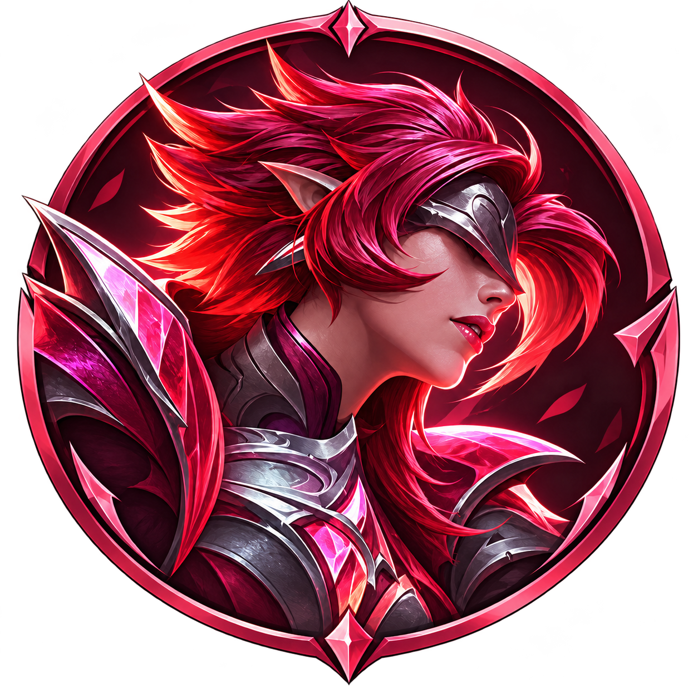
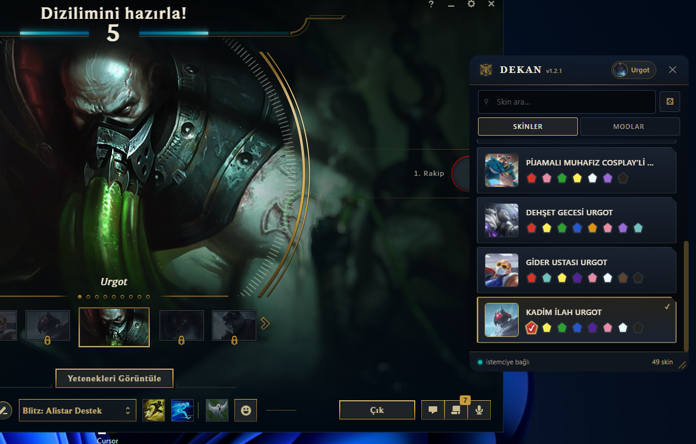
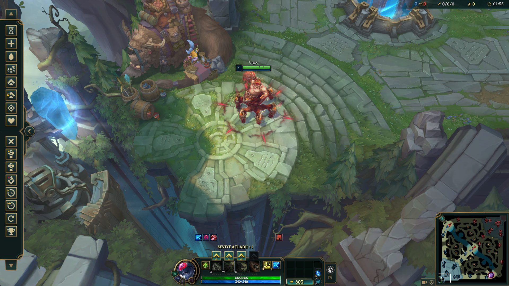

<p align="center">
  
</p>

<h1 align="center">Dekan</h1>

<p align="center">
  Open-source League of Legends skin changer and custom mod manager (<code>.fantome</code> / <code>.modpkg</code>) for Windows, written in Rust.
</p>

<p align="center">
  <a href="https://github.com/chrisssst/Dekan/actions/workflows/ci.yml"></a>
  <a href="https://github.com/chrisssst/Dekan/releases/latest"></a>
  <a href="https://github.com/chrisssst/Dekan/releases/latest"></a>
  <a href="https://github.com/chrisssst/Dekan/stargazers"></a>
  
  
  <a href="https://github.com/chrisssst/Dekan#installation"></a>
</p>

<p align="center">
  <a href="https://github.com/chrisssst/Dekan/releases/latest"><b>Download</b></a> ·
  <a href="https://github.com/chrisssst/Dekan#installation"><b>Installation Guide</b></a> ·
  <a href="https://github.com/chrisssst/Dekan#build-from-source"><b>Build Guide</b></a> ·
  <a href="https://github.com/chrisssst/Dekan/issues"><b>Issues</b></a>
</p>

> [!WARNING]
> **Educational Project & Disclaimer:** Dekan is developed strictly for **educational and research purposes**. It is provided as is, without warranty of any kind. The author takes **no responsibility** for any account penalties, bans, damages, or consequences resulting from using or misusing this software. You use it at your own risk.

---

## Overview

Dekan reads your installed League of Legends archives (`DATA/FINAL/Champions/*.wad.client`) to generate and load skins, chromas, Exalted forms (`Ctrl+5`), TFT cosmetics, and custom mods locally at match start without modifying Riot's game files.

<p align="center">
  
  
</p>

## Native in-client mode

Choose **Native in client** in the **Skin picker mode** card on Home to use the League client carousel and Dekan menu. The verified helper may request administrator approval to install its client launch shim and restart the interface while idle. Dekan itself remains unelevated. If the client connection fails, use the standalone picker. Choose **Dekan interface** to remove the script and its shim; removal may request administrator approval. Native mode has not yet been validated in a live match.

## Installation

> **Step-by-step installation tutorial:** Download the Windows installer below. The source build instructions are included in this README.

### Windows (10 / 11 x64)

Download the [latest released Windows installer](https://github.com/chrisssst/Dekan/releases/latest), install Mod Manager (LTK Manager 1.33.0 or newer), and start Dekan. The Dekan installer includes the supplied native tools. Alternatively, run in **PowerShell**:

```powershell
irm https://raw.githubusercontent.com/chrisssst/Dekan/main/install.ps1 | iex
```

## Features

- **Skins, Chromas & Forms (`Ctrl+5`):** Supports 170+ champions and 9,000+ skins, chromas, Exalted, Ultimate, and Hall of Legends forms, plus localized loading-screen names.
- **Dekan Interface:** Pick skins in the themed Dekan window or enable the native League client carousel and Dekan menu, without Pengu Loader.
- **TFT Generation:** Includes updated generation support for TFT cosmetic assets.
- **Custom Mods (`.fantome`, `.modpkg`, `.zip`):** Import and repair custom skins, maps, HUDs, fonts, and announcers.
- **Party Mode:** End-to-end encrypted (`XChaCha20-Poly1305`) skin and identity sync with up to 5 friends.
- **All Regions & Languages:** Works across all Riot servers (including WeGame/CN), Classic Rift (JADE), and supports **Türkçe** and **English**.
- **Themes:** Classic, Crimson and Obsidian themes, with the saved selection retained across launches.
- **Discord Rich Presence:** Retains the Dekan presence integration.

## FAQ

**Where is the full installation tutorial?**
See the **[installation guide](https://github.com/chrisssst/Dekan#installation)**.

**Does Dekan modify my League of Legends installation?**
No. Overlays are built separately and loaded in memory at match start. Your game files stay untouched.

**Does it require Administrator privileges or Pengu Loader?**
Dekan normally runs without Administrator privileges and does not use Pengu Loader. Its default skin picker is the standalone Dekan window, with an opt-in native client mode. The supplied native launcher follows its own Mod Manager startup requirements.

**Can other players see my skin?**
Only locally, unless you and your friends enable **Party Mode** inside Dekan.

**Where can I read how Dekan works internally?**
Check the **[Build Guide](https://github.com/chrisssst/Dekan#build-from-source)**.

## Build from Source

```powershell
cargo xtask check
cargo xtask package
cargo xtask installer
```

## License

[MIT License](LICENSE) · [THIRD-PARTY-NOTICES.md](THIRD-PARTY-NOTICES.md)
