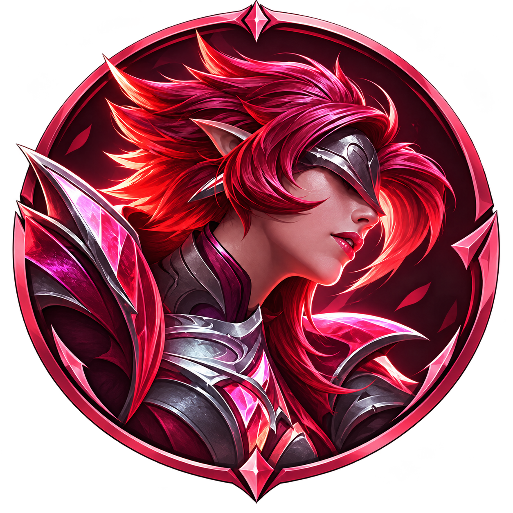
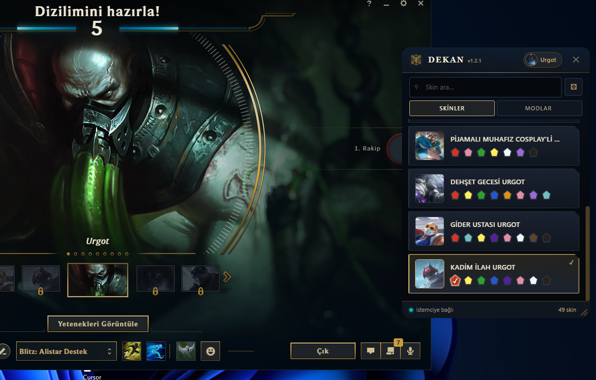
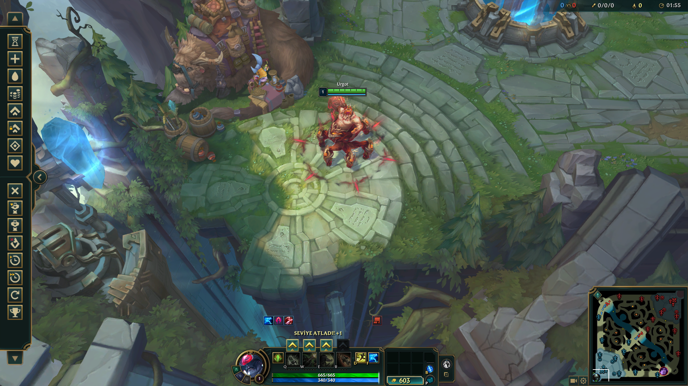

<p align="center">
  
</p>

<h1 align="center">Dekan</h1>

<p align="center">
  A League of Legends skin changer for Windows, written in Rust.<br>
  <em>The right skin loads into the match — every mode, every time.</em>
</p>

<p align="center">
  <a href="https://github.com/chrisssst/Dekan/actions/workflows/ci.yml"></a>
  <a href="https://scorecard.dev/viewer/?uri=github.com/chrisssst/Dekan"></a>
  <a href="https://github.com/chrisssst/Dekan/releases/latest"></a>
  <a href="https://github.com/chrisssst/Dekan/releases/latest"></a>
  
  
  
  <a href="https://discord.gg/dekan"></a>
</p>

<p align="center">
  <a href="https://github.com/chrisssst/Dekan/releases/latest"><b>Download</b></a> ·
  <a href="https://discord.gg/dekan"><b>Discord community</b></a> ·
  <a href="https://github.com/chrisssst/Dekan/issues"><b>Report a bug</b></a>
</p>

---

Pick any skin in Dekan's own window during champion select. Dekan builds a copy of the game files that contain
it, and when the game starts it reads that copy instead of its own. The game installation is never modified.

<p align="center">
  
  
</p>

> [!IMPORTANT]
> **Educational project**, provided as is, without warranty. The author accepts no responsibility for any damage,
> account penalty or loss caused by its use. See the [Disclaimer](#disclaimer).

## Features

- **Every skin and chroma**, including form skins, chosen in champion select and loaded when the game starts.
- **Dekan features**: Classic, Crimson and Obsidian themes, Discord Rich Presence and your existing preferences.
- **Random skin and history**: roll one, or reuse the last skin you played on each champion.
- **Custom mods**: `.fantome`, `.zip` and `.modpkg`, checked and adjusted against the current patch before use.
- **Classic Rift**: legacy champion models, generated from your installed game.
- **Party mode**: friends see each other's skins through an end-to-end encrypted relay, up to five players. Friends
  in the same lobby need no code.
- **Always up to date**: skins are generated from the game you have installed, so a patch never breaks them.
- **Safe by design**: runs without administrator rights, never writes to the game folder, verifies every binary
  and collects no telemetry.
- **Updates you approve**, verified against the release's signed checksum list.
- Turkish (default) and English. **Free and open source**: if you paid for it, you were scammed.

## Installation

1. **Install Dekan.** Download `Dekan-Setup-<version>-x64.exe` from
   [Releases](https://github.com/chrisssst/Dekan/releases/latest) and run it, or from PowerShell (not as
   administrator):

   ```powershell
   irm https://raw.githubusercontent.com/chrisssst/Dekan/main/install.ps1 | iex
   ```

   The script checks the installer against the release's `SHA256SUMS` and its Authenticode signature before
   installing.

2. **Add the injector.** Dekan uses two files from League Toolkit, `ltk_patcher_host.exe` and
   `ltk_patcher_dll.dll`, which are not bundled. On first start Dekan offers to download them from the newest
   [LTK Manager](https://github.com/LeagueToolkit/ltk-manager) release, checks their signature and copies them
   into `C:\Program Files\Dekan\tools` (Windows asks for permission only for that copy). To copy them by hand
   from an installed LTK Manager, in PowerShell **as administrator**:

   ```powershell
   Copy-Item "$env:ProgramFiles\LTK Manager\ltk_patcher_host.exe", "$env:ProgramFiles\LTK Manager\ltk_patcher_dll.dll" "$env:ProgramFiles\Dekan\tools" -Force
   ```

   Dekan refuses any file not signed by League Toolkit's publisher (Natoken LLC), and tells you when a newer
   injector is needed after a patch.

3. **Start Dekan** from the Start menu, normally (not as administrator). It lives in the system tray.

## Usage

1. Open the League client and Dekan, in either order.
2. Pick a champion in champion select. Dekan's window lists its skins and chromas.
3. Choose one and play.

Custom mods go into the category folders under `%LOCALAPPDATA%\Dekan\custom_mods`, or are imported from the
**Mods** tab. Party rooms are created from the tray, or offered automatically when friends running Dekan share
your lobby. Optional settings are listed in [`.env.example`](.env.example).

How it works, step by step: [docs/flows.md](docs/flows.md).

## Troubleshooting

Logs are in `%LOCALAPPDATA%\Dekan\logs` (the tray opens the folder); `DEKAN_LOG=debug` adds detail. **Export
diagnostics** in the control panel zips everything needed for a report. If a skin or mod breaks match loading,
turn off **Inject skins** in the control panel. Close LTK Manager while Dekan runs: two injectors conflict.

Attach the log when you open an [issue](https://github.com/chrisssst/Dekan/issues), or ask on
[Discord](https://discord.gg/dekan). Security issues go through a
[private advisory](https://github.com/chrisssst/Dekan/security/advisories/new).

## Building from source

```powershell
cargo xtask check
cargo xtask package
cargo xtask installer
```

The crates, CI/CD and release flow are described in [docs/](docs/README.md) and
[docs/build-and-ci.md](docs/build-and-ci.md). Contributions: [CONTRIBUTING.md](.github/CONTRIBUTING.md).

## Acknowledgements

Dekan was inspired by [Rose](https://github.com/Alban1911/Rose) and built by studying the open projects listed in
[THIRD-PARTY-NOTICES.md](THIRD-PARTY-NOTICES.md). Dekan is maintained by **chrisssst**.

## Disclaimer

Dekan is published **for educational purposes**, **as is, without warranty of any kind**, as stated in the MIT
license. The author assumes no responsibility for any damage caused by its use, including account suspensions or
bans. Using third-party software with League of Legends goes against Riot Games' Terms of Service: you decide
whether to use it and bear the consequences. Dekan only changes what you see on your own machine. It is not
affiliated with or endorsed by Riot Games; League of Legends is a trademark of Riot Games, Inc.

<p align="center">
  <a href="https://slint.dev"></a>
</p>

## License

[MIT](LICENSE). The LTK patcher binaries are not part of this repository and are governed by the LTK Patcher
License; every third-party license is in [THIRD-PARTY-NOTICES.md](THIRD-PARTY-NOTICES.md).
